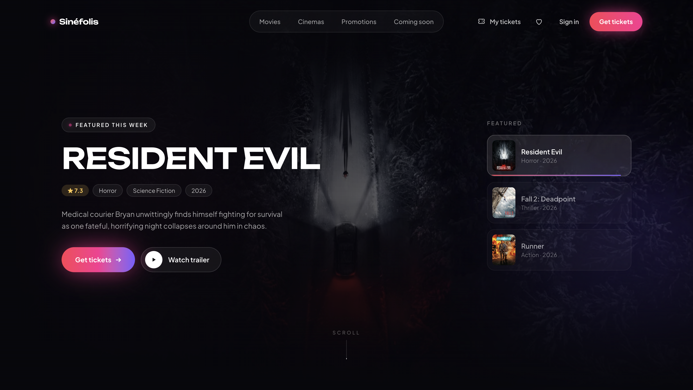

# Sinéfolis

**A cinema booking web app — redesigned and rebuilt from my Human–Computer Interaction course prototype.**

Browse movies now showing in Indonesia, watch trailers, pick a showtime and seats, apply a promo code, and get an e-ticket with a QR code.

**Live demo → [sinefolis-cinema.vercel.app](https://sinefolis-cinema.vercel.app)**



---

## About the project

Sinéfolis began as a Figma prototype I designed for my HCI course. Looking back at it later, I found several usability problems:

- The sticky navbar had no background, so it **overlapped content** while scrolling.
- The first screen was a **dark, empty hero** with no headline or call to action.
- Date and showtime pickers had **no clear selected state**, so users couldn't tell what they had chosen.
- Promotions and cinemas were **repeated placeholder cards**, and some copy had typos and impossible dates.

I redesigned the interface around a clearer booking flow and stronger visual hierarchy, then built it as a working web app that uses real movie data.

| | |
|---|---|
| **Role** | Solo — UI/UX redesign and frontend development |
| **Type** | Personal project, based on my HCI course work at BINUS University |
| **Delivered** | Live web app · 9 pages · real now-showing data from TMDB |

## Features

**Booking flow**
- Home with an auto-rotating featured carousel, Now Showing / Top Rated tabs, cinemas, promotions, and Coming Soon
- Movie details with trailer (YouTube), runtime, age rating, director, and cast
- Showtimes for two weeks, filterable by cinema (8 locations across 4 cities)
- Interactive seat map with taken seats, a booking limit, and a live price total
- Checkout with a seat-hold countdown, promo codes, and three payment methods (demo only)
- E-ticket with a QR code

**Account features**
- Sign in / sign up (demo, stored in the browser)
- Watchlist (requires sign-in)
- My Tickets — upcoming tickets and history, no sign-in needed
- Audience reviews, with the option to review after booking

**Promotions**
- Rotating ad banner, category filters, search, and a detail view with terms & conditions and a copyable code

**Performance & polish**
- Response caching and in-flight request de-duplication
- Detail data prefetched when hovering a movie card
- Skeleton loading states and lazy-loaded images that fade in
- Motion design: 3D tilt cards, hero carousel, layout transitions — respects `prefers-reduced-motion`
- Responsive layout for desktop and mobile

## Tech stack

| Area | Tools |
|---|---|
| Design | Figma |
| Frontend | React, Vite, React Router |
| Styling | Tailwind CSS v4 |
| Animation | Motion (formerly Framer Motion) |
| Data | TMDB API |
| Backend | Vercel Serverless Functions |
| Hosting | Vercel |

## How it works

```
Browser (React)  ──►  /api/movies, /api/movie  ──►  TMDB API
                      (Vercel serverless functions,
                       TMDB token kept server-side)
```

The React app never sees the TMDB token. It calls two small serverless functions in `/api`, which add the token, request data from TMDB, and cache the response for an hour on Vercel's edge. If TMDB can't be reached, the app falls back to built-in sample data so it still works.

Account data, tickets, watchlist, and reviews are stored in the browser's `localStorage` — there is no database in this version.

## Project structure

```
sinefolis/
├─ api/                    Serverless functions (TMDB proxy)
│  ├─ movies.js            now playing, upcoming, top rated, genres
│  └─ movie.js             one movie + credits, videos, age ratings
├─ src/
│  ├─ components/          Navbar, Footer, MovieCard, ETicket, Promo, …
│  ├─ context/             AppContext — account, watchlist, tickets, reviews
│  ├─ data/                Sample data, cinemas, showtimes, promotions
│  ├─ hooks/               useHomeMovies, useMovieDetail
│  ├─ lib/                 TMDB client: data mapping and caching
│  ├─ pages/               Home, MovieDetail, Seats, Payment, Confirmed,
│  │                       Promotions, Tickets, Watchlist, SignIn
│  ├─ App.jsx              Routes
│  └─ index.css            Tailwind theme (colors, fonts, animations)
└─ vercel.json             SPA routing
```

## Run it locally

You need [Node.js](https://nodejs.org) (LTS) and a free [TMDB](https://www.themoviedb.org/settings/api) account.

```bash
git clone https://github.com/vaniallic/sinefolis.git
cd sinefolis
npm install
```

Create a `.env` file in the project root (see `.env.example`) and add your TMDB **API Read Access Token**:

```
TMDB_TOKEN=your_tmdb_read_access_token
```

Start the app together with the API functions:

```bash
npx vercel dev
```

Then open [http://localhost:3000](http://localhost:3000).

> `npm run dev` also works, but without the `/api` functions — the app will show sample data instead of TMDB data.

## Deploy

1. Import the repository on [Vercel](https://vercel.com) (framework preset: Vite).
2. Add the environment variable `TMDB_TOKEN`.
3. Deploy. Every push to `main` redeploys automatically.

## What I learned

- Turning a static Figma prototype into a real, multi-page React app with routing and shared state
- Keeping an API key out of the browser with serverless functions
- Designing for loading states — caching, prefetching, and skeletons make an app *feel* fast
- Fixing UX issues I found by testing my own earlier design

## Notes

- Showtimes, cinemas, prices, and payments are **simulated** — Indonesian cinema chains don't offer a public API. No real payment is processed.
- This product uses the TMDB API but is not endorsed or certified by TMDB.

## Author

**Vania Alicia Yocelin** — Computer Science student at BINUS University
GitHub: [@vaniallic](https://github.com/vaniallic)